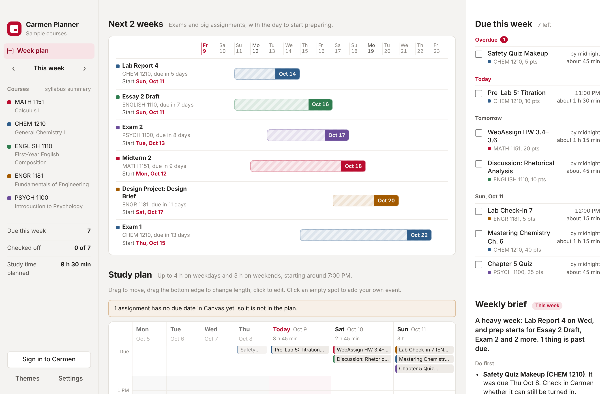
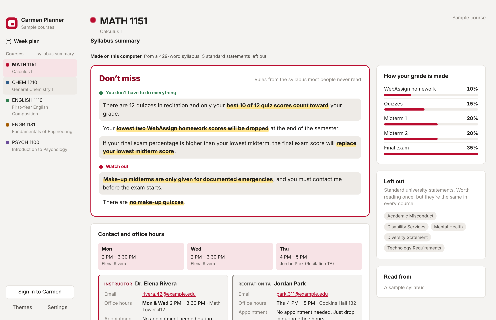
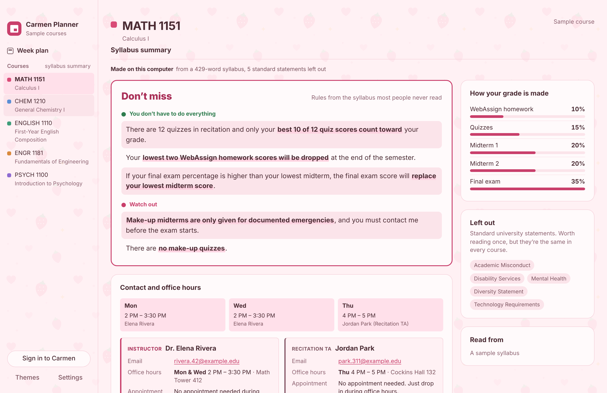

# Carmen Planner

A desktop app for Mac and Windows that turns your Canvas courses into a weekly task list, a study plan, a weekly brief, and a one-screen summary of every syllabus with each instructor's and TA's contact details and office hours.

Sign in to Carmen (Ohio State's Canvas) inside the app, the same way you always do. Carmen Planner reads your courses and due dates, shows what is due this week, spreads the work across your evenings, and warns you about exams and big assignments coming up in the next two weeks, with the day you should start preparing.



## What it does

- **Due this week.** Every assignment, quiz and exam due this week, grouped by day, with overdue work at the top. Check things off as you finish them.
- **Study plan, like a calendar.** Each task gets an estimated amount of time and is placed on the days before it is due, within the hours you say you have. Exams and projects are split into sessions spread over the week before. Drag a block to move it, drag its bottom edge to change its length, click it to change the time or add a note, and click an empty spot to add your own event.
- **Next 2 weeks.** Exams and big assignments due in the next 14 days, with a bar showing when to start and when it is due.
- **Syllabus summary.** For each course, Carmen Planner reads the syllabus (the Syllabus page, or an uploaded PDF or Word file), leaves out the standard university statements and the day-by-day calendar, merges rules the syllabus repeats, and puts the rules most people miss at the top, highlighted: dropped scores, "only 8 of 10 required", free extensions, required labs, attendance limits and late penalties. Plus the grade breakdown, short sections on exams and materials, and a **Contact and office hours** card: each instructor and TA with their email, the days, times and place of their office hours, and whether you need an appointment (the teaching team is also read from the course's People list in Carmen).
- **Themes.** Seven color themes, two cute ones (Strawberry Milk and Cotton Candy), and your own picture as the background.
- **Weekly brief.** A short brief for the week, written on your computer from your plan: what kind of week it is, what to do first and why, where it gets tight (two exams back to back, three things due on one day), a line for each course, and the syllabus rule that matters for this week's work. It updates as you check things off.
- **Stay signed in.** No need to sign in every time you open the app. Your password is never saved; turn it off in Settings on a shared computer.
- **Update notices.** When a new version is released, the app tells you and links to the download.
- **Sample courses.** Try everything without a Canvas account.
- **Light and dark mode**, following your system setting.





## Privacy

- You sign in on Ohio State's own sign-in page, inside the app. Carmen Planner never sees your password.
- The app only **reads** your courses and assignments. It never submits, edits or posts anything.
- Course data stays on your computer. Syllabus and lecture files are read on your computer.
- No AI service is used. Everything, including the weekly brief, is worked out on your computer.
- **Keep me signed in** (on by default) keeps Carmen's sign-in cookie on your computer for up to 30 days, the same way a browser does. Carmen can still end the session sooner.
- **Sign out and clear data** in Settings removes your Canvas sign-in and all saved course data.

## Download

Get it from the website, **https://charlotte-127.github.io/carmen-planner/**, or from the [Releases page](../../releases).

| System | File |
| --- | --- |
| Mac (Apple silicon and Intel), macOS 11+ | `Carmen-Planner-mac-universal.dmg` |
| Windows 10 / 11 (64-bit) | `Carmen-Planner-win-x64.exe` |

The app is not signed with a paid Apple or Microsoft developer certificate, so the first launch shows a warning:

- **Mac:** open the .dmg and drag Carmen Planner to Applications. Right-click the app and choose **Open**, then **Open** again. On newer macOS versions, if there is no Open button, go to **System Settings → Privacy & Security** and click **Open Anyway**. If macOS says the app "is damaged", run `xattr -cr "/Applications/Carmen Planner.app"` in Terminal and open it again.
- **Windows:** if SmartScreen appears, click **More info → Run anyway**.

The installers are built from this repository by GitHub Actions. Each file's SHA-256 fingerprint is listed on its release page.

## Updating

Version 1.1 and later check for a new release when they open and show a notice with a download link. Install the new version over the old one; your courses and settings are kept.

## How the plan is made

The planner runs on your computer and does not need AI or the internet.

1. Each assignment gets a type (exam, quiz, project, lab, homework, reading, discussion, small task) from its name, and an estimated time from its type and point value.
2. Exams and big projects are placed first, in sessions of at least an hour spread over the days before they are due, using at most half of each day.
3. Everything else is placed earliest deadline first. Short tasks stay in one sitting when there is room.
4. Work due late at night can be done the same day. Exam prep always ends the day before.
5. If the work does not fit in your hours, the app tells you how much is left over.

You can change your hours, start time, day off and pace in **Settings**.

## Build it yourself

You need [Node.js](https://nodejs.org) 20 or newer.

```bash
npm install
npm start          # run the app
npm test           # test the planner
npm run dist:mac   # build the Mac .dmg (run on a Mac)
npm run dist:win   # build the Windows .exe
```

Installers go in the `dist` folder. The GitHub Actions workflow in `.github/workflows/build.yml` builds both installers on GitHub's computers: run it from the **Actions** tab, or push a tag such as `v1.0.0` to publish a release.

## Website

The download page lives in `site/index.html` and is published to GitHub Pages by `.github/workflows/pages.yml` (Settings → Pages → Source: GitHub Actions). Its download buttons always point to the newest release, and it works out the GitHub address by itself, so nothing needs editing.

## How it works

| File | What it does |
| --- | --- |
| `main.js` | Opens the windows, handles the Canvas sign-in window, reads Canvas and lecture files, stores settings |
| `preload.js` | The small, safe bridge between the interface and `main.js` |
| `renderer/planner.js` | The planning logic (no network) |
| `renderer/app.js` | The interface |
| `renderer/demo.js` | Sample courses, syllabi and modules for trying the app |
| `renderer/syllabus.js` | The syllabus summary (no network) |
| `renderer/contacts.js` | Finds instructors, TAs, emails and office hours in the syllabus (no network) |
| `renderer/filetext.js` | Reads PDF and Word syllabus files on your computer |
| `renderer/calendar.js` | The study plan calendar (drag, resize, add events) |
| `renderer/brief.js` | Writes the weekly brief from the plan and syllabus rules (no network) |
| `renderer/course.js` | The course page: syllabus summary and contacts |
| `renderer/themes.js` | Color themes; add your own picture themes here |
| `renderer/vendor/pdfjs/` | Mozilla pdf.js 4.10.38 (Apache 2.0), converted to a classic script |
| `test/*.test.js` | Tests for the planner, weekly brief, syllabus summary and contacts |
| `site/index.html` | The website with the introduction and download buttons |

Canvas data comes from the Canvas REST API (`/api/v1/courses`, `/assignments`, `/assignment_groups`, `/modules`, `/pages`, `/files`), using the sign-in session from the Canvas window. Requests are spaced out and read-only. A course's syllabus and modules are only read when you open that course.

## Adding a theme with your own picture

1. Put the picture in `renderer/themes/` (JPG or PNG, about 2400 px wide).
2. In `renderer/themes.js`, copy a theme entry, give it a new `id` and `name`, and add `image: 'themes/your-picture.jpg'`.
3. Choose colors that suit the picture. The comment at the top of `themes.js` explains each color.

Anyone can also pick their own picture inside the app: **Themes → Choose a picture**.

## Credits

PDF syllabi are read with [pdf.js](https://github.com/mozilla/pdf.js) by Mozilla (Apache License 2.0); its license is in `renderer/vendor/pdfjs/LICENSE`.

## Built with AI

Made for the Ohio State "Build what you want" AI challenge, October 2026, with Claude (Anthropic) as the coding partner. The app itself uses no AI service: the plan, the weekly brief, the syllabus summary and the notes are all made on your computer.

## Disclaimer

Carmen Planner is a student project. It is not made by, endorsed by, or affiliated with The Ohio State University or Instructure. Time estimates are guesses; always check due dates in Canvas.

## License

[MIT](LICENSE)
