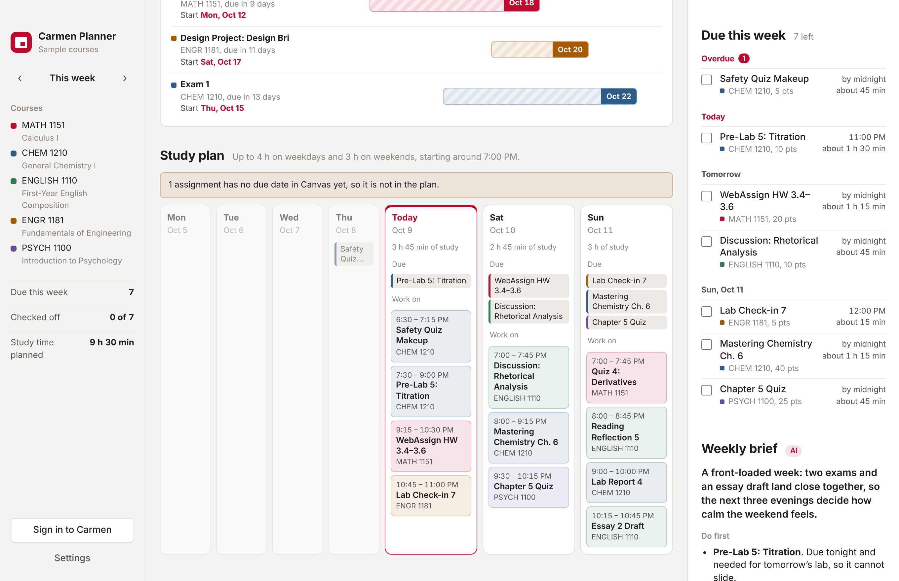

# Carmen Planner

A desktop app for Mac and Windows that turns your Canvas courses into a weekly task list and a study plan.

Sign in to Carmen (Ohio State's Canvas) inside the app, the same way you always do. Carmen Planner reads your courses and due dates, shows what is due this week, spreads the work across your evenings, and warns you about exams and big assignments coming up in the next two weeks, with the day you should start preparing.


## What it does

- **Due this week.** Every assignment, quiz and exam due this week, grouped by day, with overdue work at the top. Check things off as you finish them.
- **Study plan.** Each task gets an estimated amount of time and is placed on the days before it is due, within the hours you say you have. Exams and projects are split into sessions spread over the week before.
- **Next 2 weeks.** Exams and big assignments due in the next 14 days, with a bar showing when to start and when it is due.
- **Weekly brief (optional).** Add your own Claude API key and Claude writes a short brief for the week: what to do first, a note for each course, and crunch points to plan around.
- **Sample courses.** Try everything without a Canvas account.
- **Light and dark mode**, following your system setting.



## Privacy

- You sign in on Ohio State's own sign-in page, inside the app. Carmen Planner never sees your password.
- The app only **reads** your courses and assignments. It never submits, edits or posts anything.
- Course data stays on your computer. Nothing is sent anywhere, except to Claude when you choose to write a weekly brief with your own API key.
- Your API key is encrypted with your system's secure storage (Keychain on Mac, DPAPI on Windows).
- **Sign out and clear data** in Settings removes your Canvas sign-in and all saved course data.

## Download

Get it from the website, **https://YOUR-USERNAME.github.io/carmen-planner/**, or from the [Releases page](../../releases).

| System | File |
| --- | --- |
| Mac (Apple silicon and Intel), macOS 11+ | `Carmen-Planner-mac-universal.dmg` |
| Windows 10 / 11 (64-bit) | `Carmen-Planner-win-x64.exe` |

The app is not signed with a paid Apple or Microsoft developer certificate, so the first launch shows a warning:

- **Mac:** open the .dmg and drag Carmen Planner to Applications. Right-click the app and choose **Open**, then **Open** again. On newer macOS versions, if there is no Open button, go to **System Settings → Privacy & Security** and click **Open Anyway**. If macOS says the app "is damaged", run `xattr -cr "/Applications/Carmen Planner.app"` in Terminal and open it again.
- **Windows:** if SmartScreen appears, click **More info → Run anyway**.

## How the plan is made

The planner runs on your computer and does not need AI or the internet.

1. Each assignment gets a type (exam, quiz, project, lab, homework, reading, discussion, small task) from its name, and an estimated time from its type and point value.
2. Exams and big projects are placed first, in sessions of at least an hour spread over the days before they are due, using at most half of each day.
3. Everything else is placed earliest deadline first. Short tasks stay in one sitting when there is room.
4. Work due late at night can be done the same day. Exam prep always ends the day before.
5. If the work does not fit in your hours, the app tells you how much is left over.

You can change your hours, start time, day off and pace in **Settings**.

## Build it yourself

You need [Node.js](https://nodejs.org) 20 or newer.

```bash
npm install
npm start          # run the app
npm test           # test the planner
npm run dist:mac   # build the Mac .dmg (run on a Mac)
npm run dist:win   # build the Windows .exe
```

Installers go in the `dist` folder. The GitHub Actions workflow in `.github/workflows/build.yml` builds both installers on GitHub's computers: run it from the **Actions** tab, or push a tag such as `v1.0.0` to publish a release.

## Website

The download page lives in `site/index.html` and is published to GitHub Pages by `.github/workflows/pages.yml` (Settings → Pages → Source: GitHub Actions). Its download buttons always point to the newest release, and it works out the GitHub address by itself, so nothing needs editing.

## How it works

| File | What it does |
| --- | --- |
| `main.js` | Opens the windows, handles the Canvas sign-in window, reads Canvas, stores settings, calls Claude |
| `preload.js` | The small, safe bridge between the interface and `main.js` |
| `renderer/planner.js` | The planning logic (no network) |
| `renderer/app.js` | The interface |
| `renderer/demo.js` | Sample courses for trying the app |
| `test/planner.test.js` | Tests for the planner |
| `site/index.html` | The website with the introduction and download buttons |

Canvas data comes from the Canvas REST API (`/api/v1/courses`, `/assignments`, `/assignment_groups`), using the sign-in session from the Canvas window. Requests are spaced out and read-only.

## Built with AI

Made for the Ohio State "Build what you want" AI challenge, October 2026, with Claude (Anthropic) as the coding partner. The app itself uses Claude only for the optional weekly brief.

## Disclaimer

Carmen Planner is a student project. It is not made by, endorsed by, or affiliated with The Ohio State University or Instructure. Time estimates are guesses; always check due dates in Canvas.

## License

[MIT](LICENSE)
